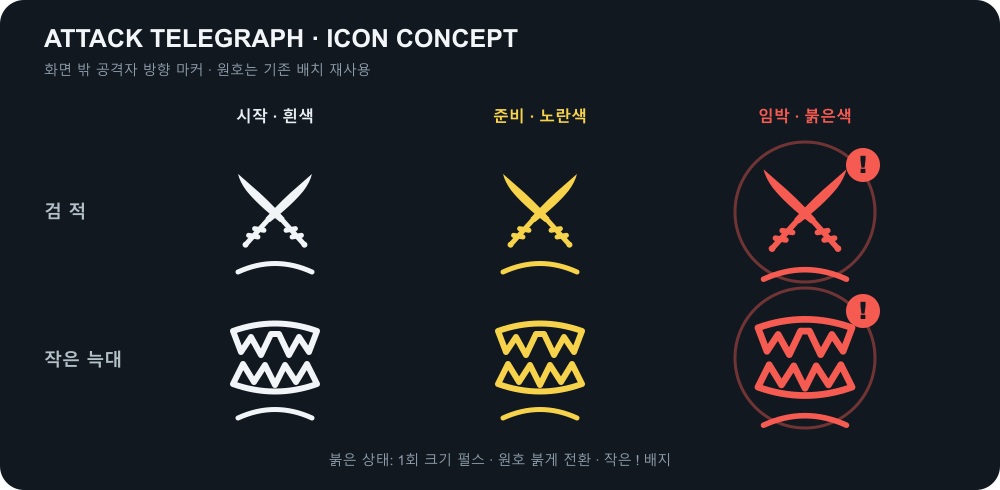

# 공격 전조 방향 인디케이터 구현 계획

- 작성일: 2026-10-26
- 상태: 코드·씬·프리팹·Sprite 연결 완료. 전체 C# Roslyn 컴파일 성공. Unity Play는 라이선스 오류로 미확인.
- 대상: 정식 1·2스테이지 `BambooStage1`, `RainyTwinBoss`의 일반 검 적 `DefenseMelee`와 작은 늑대 `DefenseBeast`. 보스·수리검·다른 적 패턴은 이번 범위에서 제외한다.

위 그림은 **형태와 상태를 결정하기 위한 시안**이다. [벡터 원본](assets/attack-telegraph-indicator-concept.svg)은 제공된 쌍검·이빨 이미지를 작은 UI에서도 읽히도록 단순화했다. 쌍검은 동양풍에 맞춰 가늘고 살짝 휘어진 카타나 두 자루로 만들고, 화살촉처럼 별도 삼각형을 붙이지 않은 일반적인 칼끝으로 마무리한다. 작은 크기에서 의미가 불분명했던 교차부 가드 선은 사용하지 않는다. 실제 게임용 Sprite, 크기, 색상은 Play 화면에서 확정한다.

## 의도와 기존 구조

- 현재 두 씬의 `DefenseDirector/CombatThreatPresentationProvider._showEnemyIndicators`는 켜져 있고, `BambooDefenseHud/FootstepMarkers`는 화면 밖 적의 발걸음 방향 아이콘과 원호를 최대 24개 표시한다. HUD는 발소리 사건의 수명과 순번을 소비한다.
- 이 두 씬에서는 **발걸음 방향 UI의 자리를 공격 전조 방향 UI로 대체**한다. 발걸음 UI 코드·계약·프리팹 구조를 삭제하지 않고, 씬별 표시 모드로 남긴다. 실제 발소리, 월드 발자국, 지면 파동, 인지 판정은 그대로 둔다.
- 공격 시도가 없는 적은 방향 아이콘을 띄우지 않는다. 적이 화면 안에 들어오면 방향 UI를 숨기는 기존 규칙을 유지하고, 화면 안 경고는 기존 몸체 붉어짐이 담당한다.
- 공격의 시작·종료 판단은 발걸음 사건이나 사운드 재생 상태가 아니라 `EnemyAttackBehaviour`의 공격 사건과 `EnemyAttackContext.AttackId`를 따른다. 사운드와 HUD는 동일한 공격 시계에서 각각 반응한다.

## 권장 시간표

기준 시각은 `TelegraphStarted`의 공격 준비 시작이다. 0.8초는 **아이콘 재생 길이만이 아니라 실제 공격 준비 시간**이다. 일시정지와 공격 취소 시에는 게임 시간 기준으로 함께 멈추거나 종료한다.

| 적 | 기존 실제 전조 | 변경할 공격 설정 | 공격까지의 소리 간격 | 아이콘 상태 |
| --- | --- | --- | --- | --- |
| 일반 검 적 `DefenseMelee` | 0.5초 준비 + 철컥 뒤 0.2초 = 0.7초 | `_firstHeartbeatDelay` 0.5→0.6초, `_postHeartbeatAttackDelay` 0.2초 유지 | 철컥 `EnemyMeleeWarning(39)`은 공격 0.2초 전 | 0~0.6초 흰색→노란색, 0.6~0.8초 붉은 강조 |
| 작은 늑대 `DefenseBeast` | 0.4초 준비 + 첫 박동 뒤 0.5초 = 0.9초 | `_firstHeartbeatDelay` 0.4→0.3초, `_postHeartbeatAttackDelay` 0.5초 유지 | 첫 박동 `EnemyHeartbeat(26)`은 공격 0.5초 전, 돌진음 `DefenseBeastLeap(48)`은 돌진 시작 때 | 0~0.6초 흰색→노란색, 0.6~0.8초 붉은 강조 |

- 두 프리팹 모두 박동 1회이므로 현재 `EnemyAttackBehaviour.TryAttack`의 계산식에서 위 설정이 각각 0.8초가 된다. `_telegraphDuration` 직렬화 값만 바꿔서는 박동 전조 시간이 바뀌지 않는다.
- 늑대의 붉은 몸체 경고와 `DefenseBeastWarning(52)` 음원은 원래 0.9초 전조에 맞춰져 있었다. 음원을 0.8초로 줄이고 마지막 0.1초에 페이드를 적용해 공격 실행 시각과 맞춘다.
- 검 적의 준비 애니메이션과 붉어짐은 첫 박동 시각에 연동돼 있다. 0.6초 변경 뒤 모션 속도·정지 구간을 Play에서 확인한다.
- 늑대 돌진 시작음은 이미 프리팹의 `_leapSound=DefenseBeastLeap(48)`로 연결돼 있다. 이 소리를 붉은 강조의 **시작**으로 쓰면 경고가 실제 돌진과 동시에 시작되어 늦다. 붉은 강조는 공격 0.2초 전 시계로 시작하고, 돌진음에는 한 번의 짧은 확정 펄스만 겹치는 안을 권장한다.

## 표시 상태와 시안

1. `TelegraphStarted`: 해당 공격자의 방향 마커 슬롯을 확보한다. 쌍검 또는 이빨 단색 아이콘과 기존 화면 중심 원호를 흰색으로 표시한다.
2. 전조 진행 0~0.6초: 흰색에서 노란색으로 부드럽게 보간한다. 크기와 불투명도는 안정적으로 유지한다. 쌍검은 카타나의 완만한 곡선과 일반 칼끝만 남기고, 세부 손잡이 무늬·치열·그런지 표현은 작은 마커에서 뭉개지므로 생략한다.
3. 남은 시간 0.2초: 아이콘과 원호를 붉게 바꾸고 크기를 약 1.15배로 한 번 키운 뒤 원래 크기로 되돌린다. 작은 `!` 배지를 아이콘 바깥쪽에 붙인다. 지속 점멸은 여러 적이 동시에 공격할 때 방향 가독성을 떨어뜨릴 수 있어 1차안에서는 쓰지 않는다.
4. `AttackCommitted`: 늑대의 돌진음과 함께 붉은 원호를 짧게 한 번 밝히고, 공격 방향 표시는 실행 구간에 필요한 시간만 유지할지 Play에서 정한다. 검 적은 철컥 뒤 0.2초 경고가 끝나면 실행 전환을 알리고 정리한다.
5. `AttackCancelled`·공격 종료·적 사망/비활성·생성 세대 변경·세션 종료·표시 옵션 끔: 현재 공격 ID의 UI를 즉시 정리하고 슬롯을 반환한다. 이전 공격의 늦은 종료 사건이 다음 공격 마커를 지우지 않게 한다.

## 구현 경로

1. `Assets/Scripts/Combat/Contracts/ThreatPresentationContracts.cs`에 공격 전조 전용 스냅샷/사건을 추가한다. 세션, 공격자 `CombatEntityKey`, `AttackId`, 적 유형, 시작 시각·실제 전조 길이, 상태, 기존 방향·거리·가시성 결과를 담는다. 발소리 계약은 유지한다.
2. `Assets/Scripts/Defense/CombatThreatPresentationProvider.cs`가 같은 씬의 활성 `DefenseMelee` 근접 공격과 `DefenseBeastLeapAttack`을 구독한다. `TelegraphStarted`·`AttackCommitted`·`AttackCancelled`·`AttackEnded` 및 사망/재사용을 연결하고, 표시 중에는 공격자의 **현재 위치**로 기존 카메라 상대 방향·화면 안 판정·거리 크기를 갱신한다. 사운드 ID를 감시해 상태를 추측하지 않는다.
3. 공급자 Inspector에 적 방향 UI의 표시 모드(발걸음/공격 전조)와 공격 전조 표시 옵션을 명확히 둔다. 정식 1·2스테이지는 공격 전조 모드를 선택한다. 발걸음 사건 공급과 기존 모드는 코드에 남기며, 공격 전조 모드의 HUD는 발걸음 스냅샷을 화면에 그리지 않는다. 수리검 인디케이터 설정은 독립적으로 유지한다.
4. `Assets/Scripts/UI/CombatHud/CombatFootstepHud.cs`와 `CombatFootstepMarker.cs`는 현재 24개 슬롯·방향 원호·배치를 재사용하도록 확장한다. 씬 모드에 따라 구독할 사건을 고르고, 공격 모드에서는 `공격자 생성 세대 + AttackId`로 갱신을 걸러낸다. 같은 공격자의 새 발걸음은 마커 상태를 건드리지 않는다. 이름 변경은 호환성과 범위를 확인한 뒤 필요한 최소한으로만 한다.
5. `Assets/Scenes/Defense/UI/CombatFootstepMarker.prefab`에 쌍검·이빨 단색 Sprite와 선택적 `!` 배지를 연결한다. 디자인 원본은 벡터로 관리하고 Unity용 투명 Sprite로 내보낸다. 현재 발걸음 Sprite 연결은 기존 모드용으로 보존한다.
6. `Assets/Resources/Defense/DefenseMelee.prefab`과 `DefenseBeast.prefab`의 첫 박동 지연만 위 표대로 바꾼다. 두 씬의 `DefenseDirector` 표시 모드와 공용 HUD 연결을 저장한다. 보스·다른 프리팹의 공격 시간은 변경하지 않는다.
7. 구현 후 `docs/features/전투_HUD.md`, `적_공격_패턴.md`, `DefenseBeast.md` 및 기능 목록을 실제 동작에 맞춰 갱신한다.

## 검증 기준

- 편집기에서 두 프리팹의 실제 `EnemyAttackContext.TelegraphDuration`이 각 0.8초인지 확인한다. 검 철컥은 실행 0.2초 전, 늑대 박동은 실행 0.5초 전인지 확인한다.
- 1·2스테이지에서 화면 밖 검 적·늑대가 공격을 시도할 때만 맞는 아이콘과 방향 원호가 뜨며, 발걸음만으로는 표시되지 않는지 확인한다. 화면 안 진입, 카메라 회전, 거리 변화도 확인한다.
- 노랑 전환과 마지막 0.2초의 붉은 강조가 실제 공격과 맞는지, 늑대 돌진음은 실행 때 들리는지 확인한다. 취소·처치·풀 재사용·세션 종료 뒤 유령 마커가 남지 않아야 한다.
- 다수 적이 동시에 시도할 때 24개 슬롯 한도와 방향 가독성을 확인한다. 기존 수리검 UI, 실제 발소리, 월드 발자국, 월드 적 경고가 그대로 동작해야 한다.
- 테스트 코드는 작성하지 않는다. Unity 컴파일과 두 정식 씬의 실제 Play 화면·청취로 최종 확인한다.

## 결정이 필요한 시각 세부값

- 공격 확정 뒤 붉은 마커를 최대 0.1초 보여 준 후 정리하도록 구현했다. Unity Play에서 실제 시인성은 미확인이다.
- 시안의 `!` 배지를 15px Image로 연결했다. 실제 24~36px 마커에서 읽히는지는 Unity Play에서 확인해야 한다.

## 2026-10-26 구현 기록

- `ThreatPresentationContracts`에 `AttackTelegraphPresentationSnapshot`과 아이콘 유형을 추가했다. 기존 발소리 계약과 `IThreatPresentationProvider`는 유지했다.
- `CombatThreatPresentationProvider`에 Inspector 표시 모드와 공격 전조 색·크기 설정을 추가하고, `DefenseMelee`의 근접 패턴과 `DefenseBeastLeapAttack`의 `TelegraphStarted`·`AttackCommitted`·`AttackCancelled`·`AttackEnded`를 구독한다. 공격자 생성 세대와 `AttackId`를 함께 사용하며 현재 위치·몸체 화면 진입·기존 거리/투명도 정책으로 매 프레임 다시 계산한다.
- `CombatFootstepHud`와 `CombatFootstepMarker`는 기존 24개 슬롯과 원호를 재사용한다. 표시 모드가 바뀌면 구독과 슬롯을 정리한다. 전조 모드에서는 발걸음 스냅샷을 그리지 않는다.
- `CombatFootstepMarker.prefab`에 [카타나](assets/attack-indicator-katana.svg)·[이빨](assets/attack-indicator-fangs.svg)·[위험 배지](assets/attack-indicator-badge.svg)의 투명 PNG Sprite를 연결했다. 실제 사용 PNG는 `Assets/Scenes/Defense/UI/Indicators/`에 있으며 마커 프리팹 Inspector에서 교체 가능하다.
- `DefenseMelee.prefab`의 첫 박동 지연을 0.6초, `DefenseBeast.prefab`을 0.3초로 저장하고 `BambooStage1`·`RainyTwinBoss`의 공급자 표시 모드를 공격 전조로 저장했다.
- 사용자 선택에 따라 `DefenseBeastWarning.wav`를 정확히 0.8초로 줄이고 0.7~0.8초 구간을 페이드했다. FMOD AudioFile 길이·Desktop SFX 뱅크·Unity `StreamingAssets/SFX.bank`를 갱신했고 FMOD 빌드·진단이 성공했다. 실제 게임 청취는 미확인이다.
- 후속 크기 조정: `CombatFootstepHud`에 공격 전조 전용 먼/가까운 거리 크기 44/160을 Inspector 설정으로 추가했다. Sprite 내부 여백을 반영한 쌍검 가시 폭이 수리검 아이콘의 거리별 폭과 비슷해지도록 근접도의 제곱으로 크기를 보간한다. 기존 발걸음 24/36은 유지하고 `!` 배지·방향 원호 위치는 실제 그림 폭에 맞춘다. Play 화면 검증은 미확인이다.
- Unity가 저장한 Roslyn 응답 파일로 전체 `Assembly-CSharp` 컴파일 성공, 새 오류 0건·기존 파일 경고 16건. Unity 배치 실행은 LicensingClient/WMI 오류로 프로젝트 로드 전에 종료되어 실제 Play 화면·청취는 미확인이다. 테스트 코드는 추가하지 않았다.
